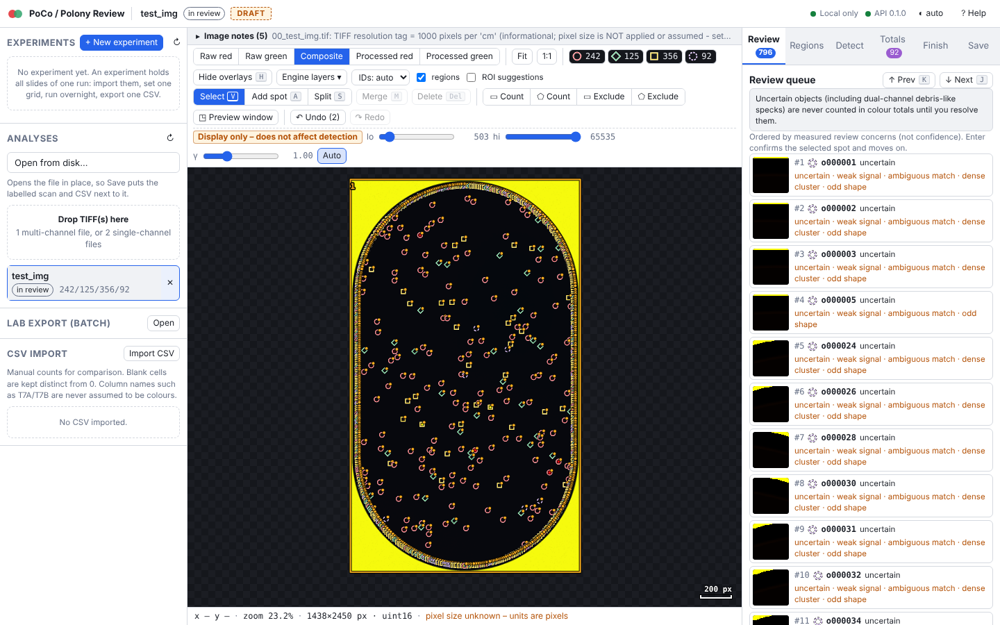

[](https://github.com/oriamos/poco/actions/workflows/ci.yml)
[](https://github.com/oriamos/poco/actions/workflows/install-test.yml)


# PoCo / Polony Review

**PoCo turns two-channel microscope TIFFs into reviewed red, green and yellow polony counts. Big-FISH and Spotiflow propose detections; a researcher reviews each counting field; the application exports lab-ready CSV/Excel files with full provenance.**



*The screenshot shows the synthetic demo slide from `resources/dataset_files/test/`, not laboratory data.*

## Who it is for

Researchers who count polonies (solid-phase single-molecule PCR spots) on fluorescence scans of counting fields, and who want a
reproducible, reviewable count instead of manual tallies alone. The application runs on your own computer; nothing is uploaded.

## The workflow

1. **Import** a two-channel TIFF (or two single-channel files).
2. **Map channels**: confirm which channel is red and which is green. File names only suggest a role.
3. **Choose fields**: generate the counting grid, click the fields to count, or randomise the grid (the seed is recorded).
4. **Detect**: Big-FISH (classical) and, optionally, Spotiflow (AI) propose spots in each field.
5. **Review and export**: approve each counting field, then export `experiment_counts.csv`, Excel workbooks in the lab's layout, and a provenance file.

TIFF import → channel mapping → field selection / grid randomisation → dual-engine detection → researcher review → CSV / Excel export

## Try PoCo in 5 minutes

You need Python 3.10–3.13, `make`, and a clone of this repository. The demo uses a synthetic slide that ships with the repository, so you do not need any laboratory data.

```bash
git clone https://github.com/oriamos/poco.git && cd poco
make app-install   # creates .venv and installs the Python dependencies (first run only)
make demo          # copies the synthetic slide to ./demo-data/input and starts the app on ./demo-data/app
```

Then follow [TRY_DEMO.md](TRY_DEMO.md): open `demo-data/input/test_img.tif`, map the channels, detect, review and export.
Expected output files and the reset command are listed there. `make demo-reset` deletes the demo folder only.

## Install (one command, no administrator rights)

Stable release **v0.1.0**. The installers download this tagged release, not the moving `main` branch.

**Windows** (PowerShell):
```powershell
irm https://raw.githubusercontent.com/oriamos/poco/v0.1.0/install/install.ps1 | iex
```

**macOS / Linux** (Terminal):
```bash
curl -fsSL https://raw.githubusercontent.com/oriamos/poco/v0.1.0/install/install.sh | bash
```

The installer puts the app in your user folder (about 650 MB; it downloads Python 3.12 only when no Python 3.10–3.13 is present) and
adds a **PoCo / Polony Review** icon to your desktop. Run the same command again to update. Your data folder is kept on update and uninstall.

**Safer alternative** (recommended if you do not want to pipe a script into a shell): download the script, verify it against the
`SHA256SUMS.txt` attached to the [v0.1.0 release](https://github.com/oriamos/poco/releases/tag/v0.1.0), read it, then run it.

```bash
curl -fsSLO https://raw.githubusercontent.com/oriamos/poco/v0.1.0/install/install.sh
shasum -a 256 install.sh      # Linux: sha256sum install.sh; compare with SHA256SUMS.txt
less install.sh
bash install.sh
```

* **AI detector (Spotiflow + PyTorch, about 0.8–2.5 GB extra):** add `--with-ai` (`-WithAi` on Windows). On Apple Silicon it uses the GPU
  when available. Intel Macs: Big-FISH only.
* Install, update, uninstall and troubleshooting: [docs/app/INSTALL.md](docs/app/INSTALL.md).
* Development branch (unstable, for testing only): set `POLONY_REF=main` before running the installer.

## What the scientific results do and do not show

* **Big-FISH** is the classical detector: a deterministic spot detector with a background subtraction and a threshold.
* **Spotiflow** is the optional AI detector. Pretrained models are used as provided; the fine-tuned candidate is not used by default.
* **Agreement between two detectors is not ground truth.** Where they agree, the count is more likely to be right; where they do not, a
  person decides.
* **Human review remains required.** Nothing is counted as final until a person approves the counting fields.
* **Training does not run automatically.** Model training is a deliberate command that you run and read.
* **Promotion does not change the default model.** Promoting a model in the registry does not make it the detector used by the React
  application. See [docs/STATUS_AND_RESULTS.md](docs/STATUS_AND_RESULTS.md) for what is and is not connected.

Results so far are in [docs/STATUS_AND_RESULTS.md](docs/STATUS_AND_RESULTS.md). In short: an exploratory evaluation on eight slides with
one annotator, and a larger fine-tuning run on saved historical data that improved agreement with the saved researcher marks on a held-out
test split. Neither is a general accuracy claim.

## Status and limitations

* **Status:** research software, release 0.1.0. The application has been run end to end on real two-channel slides against the
  researcher's marks; accuracy is partial and the defaults are not final.
* **Limitations:** pixel size is not applied to distances (everything is in image pixels unless you set it); the React application does
  not yet use the promoted model; the fine-tuned checkpoint is not in this repository (see [MODEL_CARD.md](MODEL_CARD.md)); Intel Macs
  support Big-FISH only; Apple Silicon Spotiflow runs with a CPU fallback for unsupported operations.
* **Current test results** are shown by the CI badges above and in the [CI workflow runs](https://github.com/oriamos/poco/actions).
  This README does not copy test counts, which would go stale.

## Documentation

| I want to... | Read |
|---|---|
| Try the demo | [TRY_DEMO.md](TRY_DEMO.md) |
| Install, update, uninstall, fix an install | [docs/app/INSTALL.md](docs/app/INSTALL.md) |
| Use the app, step by step | [docs/app/USER_GUIDE.md](docs/app/USER_GUIDE.md) |
| Understand a parameter or a review flag | [docs/app/PARAMETERS.md](docs/app/PARAMETERS.md) |
| Know what is validated and what is not | [docs/STATUS_AND_RESULTS.md](docs/STATUS_AND_RESULTS.md) |
| Train or fine-tune a model | [docs/app/TRAINING_GUIDE.md](docs/app/TRAINING_GUIDE.md), then [docs/app/FINE_TUNING.md](docs/app/FINE_TUNING.md) and [docs/app/LEGACY_FINETUNING.md](docs/app/LEGACY_FINETUNING.md) |
| Evaluate a model | [docs/app/EVALUATION.md](docs/app/EVALUATION.md), results so far: [docs/app/ALL_SLIDES_EVAL.md](docs/app/ALL_SLIDES_EVAL.md) |
| Model information | [MODEL_CARD.md](MODEL_CARD.md), [artifacts/README.md](artifacts/README.md) |
| Call the API | [docs/app/EXPERIMENTS_API.md](docs/app/EXPERIMENTS_API.md), and the live docs at `/docs` while the app runs |
| See what is planned | [docs/app/ROADMAP.md](docs/app/ROADMAP.md), [docs/app/SCIENTIFIC_OPEN_QUESTIONS.md](docs/app/SCIENTIFIC_OPEN_QUESTIONS.md) |
| Release notes | [CHANGELOG.md](CHANGELOG.md) |
| Contribute | [CONTRIBUTING.md](CONTRIBUTING.md), [SECURITY.md](SECURITY.md), [CODE_OF_CONDUCT.md](CODE_OF_CONDUCT.md) |
| Everything | [docs/app/README.md](docs/app/README.md) |

## Developer setup

```bash
make app        # venv + dependencies + frontend build (if npm) + server on http://127.0.0.1:8000
make app-test   # backend tests (pytest, tests/app)
make web        # rebuild the committed UI in src/polony_app/webdist after a frontend change
cd frontend && npm ci && npx tsc --noEmit && npx vitest run && npm run e2e
```

Backend: `src/polony_app` (FastAPI, SQLite, optional shared Postgres). Frontend: `frontend/` (React and TypeScript).
See [CONTRIBUTING.md](CONTRIBUTING.md) for the full checklist and the rules for scientific claims and data.

## Authors, acknowledgements and citation

* **Software design and implementation:** Ori Amos. See [AUTHORS.md](AUTHORS.md).
* **Origin and upstream attribution:** the file conventions for the historical ImageJ TIFFs were learned from
  [kirill-push/polony-counting](https://github.com/kirill-push/polony-counting) (MIT); no code was copied. See [NOTICE](NOTICE).
* **Background:** polony is a solid-phase single-molecule PCR method (Mitra & Church, 1999), adapted at the Lindell lab, Technion, to
  quantify marine viruses of a given clade in field samples.
* **Citation:** see [CITATION.cff](CITATION.cff). A preprint or paper citation will be added when one exists. <!-- TODO: add when published -->

## Feedback

Open an issue on this repository for bugs and suggestions. Use the issue templates. Do not attach laboratory images or other
research data to public issues. For security problems, see [SECURITY.md](SECURITY.md).

## License

MIT, see [LICENSE](LICENSE). Big-FISH and Spotiflow are separate projects with their own licences; see [NOTICE](NOTICE).
