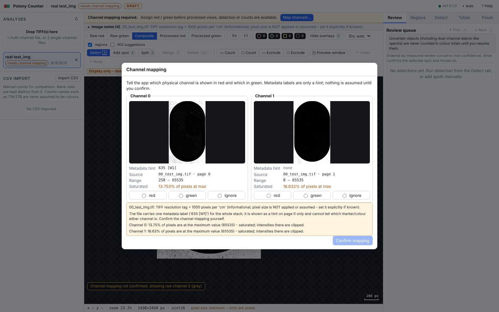
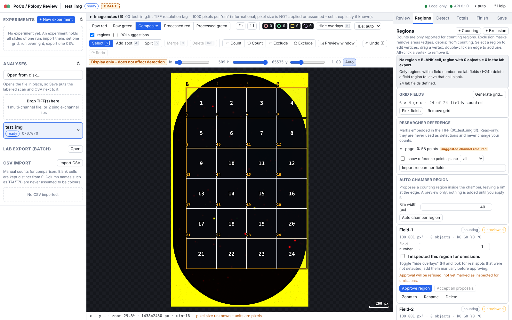
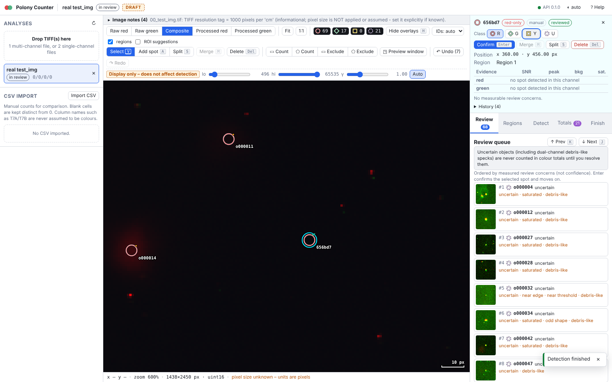
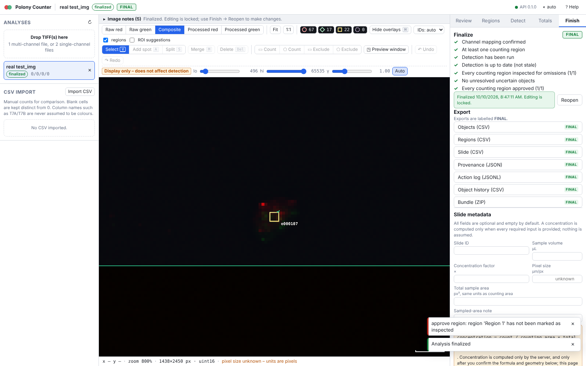

# Polony Review App: user guide

Polony Review proposes polony positions with two independent detectors (Big-FISH, a classical spot detector; Spotiflow, an AI model, when the AI extra is installed) and **you decide**. Nothing is final until a person has inspected and approved every counting field. It is a human-in-the-loop tool, not an autonomous counter.

> **Validation status.** Checked end to end on 8 real two-channel slides against the researcher's own marks ([ALL_SLIDES_EVAL.md](ALL_SLIDES_EVAL.md)); accuracy is partial and varies by slide, and the default parameters are working values, not final. Open scientific points: [SCIENTIFIC_OPEN_QUESTIONS.md](SCIENTIFIC_OPEN_QUESTIONS.md).

**Start.** Installed version: double-click the **Polony Review** icon (own window). Closing the window stops the app, unless a detection is running; then it asks ([INSTALL.md](INSTALL.md), "Window mode"). Developers: `make app`, then open http://127.0.0.1:8000 ([README.md](README.md)).

**Two ways of working**
* **One slide** (sections 1-11): open the scan, confirm the channels, make the grid and click the fields to count, detect, review, approve, save the labelled scan and CSV next to the original.
* **A whole experiment** (section 12): import all slides of a run, apply one grid, start detection on everything and go home; next morning review slide by slide and download one CSV. The per-slide steps are the same.

Screenshots in `img/` come from an earlier acceptance run; their numbers predate later fixes. Use them only to find your way around the UI.

## Layout

* **Left rail**: experiments (section 12), analyses (status chip, counts, experiment), **Open from disk**, TIFF upload (drag and drop), CSV import.
* **Centre**: viewer (wheel zoom about the cursor, drag to pan, Fit / 1:1, five views, contrast sliders that affect display only, coordinate readout, scale bar) and toolbar.
* **Right panel**: inspector; tabs **Review**, **Regions**, **Detect**, **Totals**, **Finish**. `?` opens the shortcut list.

## 1. Open a scan

Click **Open from disk** (left rail; in window mode **Browse...** opens the system file dialog): the app learns the scan's folder and Save writes next to it. Or drop one multi-page TIFF (two channels), two single-channel TIFFs, or an RGB composite. Originals are copied (never modified) and hashed (sha256). Embedded ImageJ ROIs/overlays are only **suggestions**; the TIFF resolution tag is information only. **Pixel size is never assumed.** An RGB composite has no raw channels, so per-channel detection is only approximate; the UI says so.

## 2. Channel mapping (mandatory)

A dialog asks which physical channel is **red**, which is **green**, or **ignore**. Metadata such as `635 [W1]` is only a hint; file names are not proof. Detection, approval and finalizing are blocked until you confirm. Changing the mapping later makes the detection stale and clears all approvals and inspection marks; a confirmed red<->green swap mirrors object classes and evidence ([RERUN_POLICY.md](RERUN_POLICY.md)). A residual channel offset can be estimated/applied as an integer green->red shift through the API only (`POST /api/analyses/{id}/alignment`; no UI control yet); the estimate is only a suggestion and was unreliable on test_img because the channels share little structure.

## 3. Regions and exclusions

Usual counting regions are the **grid fields** (below). You can also draw a **counting region** (rectangle or polygon tool; drag vertices, double-click an edge adds one, Alt+click removes one) and **exclusion masks** over rim glare, saturated area outside the chamber, debris or artefacts. Only objects inside a counting region and outside every exclusion are counted; approval is per counting region. One geometry rule (pixel centres, half-open edges) serves detection, membership and area (pixel-centre counts). The automatic threshold is computed only from the masked area, so a sensible region improves detection itself, not only the counts.

### Grid: click to select, Randomise

Regions tab, **Generate grid…**: rows, columns, cell size, origin, numbering order, start corner. **Preview on image** shows the grid (dashed cyan) before anything is stored.

* **Apply** stores the grid with the analysis (survives a reload) and creates one counting region `Field-N` per cell. The tool switches to **Pick fields**: click a field to count it, click again to skip it (skipped = blank in the CSVs; counted with no polonies = 0). Counted fields: solid outline and number; skipped: dotted grey outline. Keys: **A** all, **N** none, **I** invert, **Esc** leaves the tool. A field fully inside an exclusion mask cannot be switched on.
* **Randomise** keeps rows, columns and cell size and moves the whole grid to a random whole-pixel position inside the image. The seed is recorded (under *Grid fields* and in `provenance.json`) so the position can be reproduced. Ctrl+Z undoes it.
* Applying again (or randomising) keeps each field's on/off choice by field number. A field that does not move keeps its approval; one that moves loses it, as with a hand edit. **Apply** always uses the origin in the form (no random shift).
* **Remove grid** deletes the grid and its field regions; refused while a grid field is approved.

Rectangle and polygon tools stay available for exclusions and for slides without a grid.

## 4. Parameters and preview

**Detect** tab: the parameters of [PARAMETERS.md](PARAMETERS.md) for red and green, and the match tolerance. **Preview on selected window** (drag a window) shows temporary dotted amber rings of what the current parameters would find; nothing is saved.

Set the spot radius to the visible blob size first and keep it matched to the real spots. The debris-like flag is relative to the radius (sigma below about 0.6 x radius counts as compact), so a radius that is too large turns genuine small polonies into `debris_like` / `uncertain` (synthetic test: all 144 small dual-channel polonies with sigma 1.5-3 px were `uncertain` at radius 5). The threshold is in noise units (LoG response / its robust noise sigma), independent of brightness; below about 5 is noise. If a channel is empty or nearly empty, the run shows a WARNING (noise-regime threshold or mostly debris-like spots): confirm visually before trusting its count.

## 5. Detection

**Detection engine** (top of the Detect tab): *Big-FISH* (always available), *Spotiflow* (AI; needs the `--with-ai` install and a model, fetched once) or *Hybrid* (both; agreement / disagreement shown as layers, [TWO_ENGINE.md](TWO_ENGINE.md)). On a Mac the panel shows which device Spotiflow uses (GPU via MPS, or CPU).

**Spotiflow model.** The model picker lists the **promoted model (default)**, the pretrained models and registry candidates. The default setting `active` is the promoted model of the model registry, or the pretrained `general` model when none is promoted. After `promote`, normal detection uses the promoted model; you can also pick a registry candidate by id. A fine-tuned model runs with its own training downscale, normaliser and saved threshold.

**Run detection** starts a background job (progress, cancel). Objects have four classes:

| Class | Meaning |
|---|---|
| `red` | red-only: a spot in the red channel with no partner in the green channel within the match tolerance |
| `green` | green-only: the same for green |
| `yellow` | dual-positive: a red and a green spot paired one-to-one within the tolerance (position = mean of the two) |
| `uncertain` | unresolved: ambiguous red/green association, or debris-like in both channels of a pair. **Never included in any colour total**, reported separately, and blocks approval until you reclassify or delete it |

"Re-run detection" keeps your edits and reviewed objects, replaces only untouched automatic ones, never resurrects deleted objects, and clears approvals of regions whose objects changed ([RERUN_POLICY.md](RERUN_POLICY.md)).

## 6. Review queue

The **Review** tab lists objects with a measured concern, most urgent first (`uncertain`/`ambiguous_match`, `saturated`, `weak_signal`/`near_threshold`, `debris_like`, `dense_cluster`, `suspicious_shape`, `near_edge`), then by position. **J / K**: next/previous item. **Enter**: mark reviewed and advance. Objects without a reason are not queued but are still your responsibility: use region inspection (section 8).

Reasons (cut-offs in [PARAMETERS.md](PARAMETERS.md); unvalidated starting points). Weak signal, near threshold, saturated, dense cluster, suspicious (elongated or oversized) shape, near edge, ambiguous match: as named.

* **Reject debris-like Big-FISH-only candidates** (button above the queue, shown when both engines ran): deletes in one undoable step every unreviewed automatic candidate that only Big-FISH found and that is also `debris_like`. On 7 research slides 97 % of these (333 of 345) had no researcher mark within 10 px, against 18 % of the other Big-FISH-only objects. It is your decision, recorded in each object's history; Ctrl+Z restores all of them. Reviewed and manually added spots are never touched.
* **debris-like**: more compact/sharp than a typical polony (small-scale LoG response >= large-scale response); autofluorescent dust is typically small, very bright and visible in both channels. A **flag, not a verdict**: some real, small young polonies look like this. A pair debris-like in both channels is shown as `uncertain`, not yellow.
* **uncertain**: the app declines to choose; look at both channels and decide.

## 7. Edits

| Action | How |
|---|---|
| Move | drag a spot with the select tool |
| Add | tool Add (A), click empty space; class from the toolbar or R/G/Y/U. Only inside a counting region |
| Delete | select, Del (soft delete; kept in history; suppresses re-detection at that spot) |
| Reclassify | select, R / G / Y / U |
| Merge | select two or more, M: one object at the centroid, evidence united |
| Split | select one, S, click the two new positions |
| Confirm | Enter (marks reviewed) |
| Undo / redo | Ctrl+Z / Ctrl+Shift+Z (server-side, survives restarts) |

Edited automatic objects get `origin = edited`; added ones `origin = manual`.

## 8. Region inspection (checking for omissions)

The detector can miss real spots and the queue cannot show what was not detected. For each counting region:

1. Press **H** to hide overlays; look at raw/processed channels (views 1-5, zoom) for real spots without a marker. Add them with the Add tool.
2. Tick **"I inspected this region for omissions"**.
3. Optional **Accept all proposals**: marks all non-deleted, non-uncertain objects of the region reviewed (refused until the region is marked inspected). It is a bulk confirmation; use it deliberately.
4. Resolve every `uncertain` object (reclassify or delete).

## 9. Approval

**Approve region** requires: region inspected, zero unresolved `uncertain`, detection not stale and detection having run (or objects existing). Approval is bound to a fingerprint of the region polygon, overlapping exclusions, the ids/positions/classes of its objects, the channel roles and the alignment. **Any later change inside the region (add, move, delete, reclassify, merge, split, re-detection, region/exclusion edit, mapping or alignment change) clears its approval.** Un-approve is always possible. Undo that restores an identical state restores a valid approval.

## 10. Finalize and reopen

**Finish** tab: a checklist. **Finalize analysis** is enabled only when at least one counting region exists, every counting region is approved, the channel mapping is confirmed and the detection is not stale. After finalizing, all mutating actions return an error (`analysis_finalized`) and exports are labelled FINAL. **Reopen** returns to review: approvals are kept but each is cleared by the first edit inside its region; undo history is not restored. Finalize and reopen are logged.

## 11. Save: labelled scan and CSV next to the original

1. **Open from disk** (left rail) opens a TIFF in place, so the app knows its folder. (A dragged-in upload has no folder: the Save tab asks for an output folder.) Confirm the channel mapping.
2. Create the grid (section 3), run detection, review and approve.
3. **Save tab**:
   * *What to count*: tick red only / green only / yellow (red + green); each ticked colour becomes its own row. Optionally also tick a combined row (red + yellow together, green + yellow together). Every row also becomes its own row in the experiment CSV.
   * *Grid fields to count*: click a field to switch it off (bad area) or on. Off = left out of the CSV; counted with no polonies = 0. The CSV lists the counted fields one by one (Field1, Field2, ...) in grid order, whatever their grid numbers are; at most 24 fields can be counted.
   * **Save** writes next to the original scan (`<name>` = file name without extension; the original is never modified):
     * `<name>_labeled.tif`: RGB scan with the grid, per-field counts and a ring around every counted object (orange red-only, cyan green-only, yellow yellow).
     * `<name>.csv`: `SlideID, Color, Total number of polonies, Field1 ... Field24`: one row per ticked colour (`Color` = red / green / yellow, or the combined text such as `red and yellow`), all in this one file.
     * `experiment_counts.csv` (one per folder): `Slide name, What counted, NofPol, NofGrids, Field1 ... Field24`. Saving the same slide + "what counted" again replaces its row; other slides are kept. An existing file with a different header is never overwritten.
   * Save does not require finalizing; uncertain objects are never counted; the report lists unapproved fields.

API: `GET /api/fs/list`, `POST /api/analyses/open-path`, `PUT /api/analyses/{id}/grid`, `PUT /api/analyses/{id}/grid-selection`, `POST /api/analyses/{id}/save-slide`.

## 12. Experiments (many slides, one run overnight, one CSV)

An **experiment** holds all slides of one run (it replaces the old *Batch upload* panel).
1. **Create.** Left rail > **Experiments** > **+ New experiment**: name (e.g. `Clade run 12`), optional notes, and the detector for the night run (Big-FISH, or Hybrid / Spotiflow when the AI extra is installed). With an analysis open, tick *Use the detection parameters of the open analysis* to reuse its tuned thresholds.
2. **Import.** Drop all TIFFs anywhere on the experiment page (or click the drop box). One file = one slide, in file order. Unreadable files are listed with the reason; the others are imported.
3. **Channel mapping.** **Open** the first slide, confirm red / green, return with **← experiment name**. **Copy the mapping of “slide” to N slides…** applies it to every slide with the same file layout (only if all files were scanned the same way). Slides imported later get the mapping automatically.
4. **Grid for all slides.** On one slide, make the grid (Regions tab > Grid generator, click fields). On the experiment page the **Grid for all slides** box shows it as the *Template*: (a) **Apply to slides without grid**: copies it (rows, columns, cell size, position, skipped fields) to every slide without one. (b) **Apply to all slides…**: also replaces existing grids. It first says how many slides have a grid and how many have approved fields; a field keeps its approval only if it did not move. (c) **Randomise on all…**: moves each slide's grid to its own random position (fresh seed per slide; cell size and number never change). Hover a row's *Grid* cell for its seed; seeds are also in the provenance. (d) A slide whose image size differs from the template is flagged *grid may exceed image*. Finalized slides are never changed. The grid is stored in the experiment, so later slides get it with one click.
5. **Run overnight.** **▶ Run all slides** detects the slides one after another on the server; you can close the browser tab (keep the app running and the computer awake). A failed slide (no mapping, no grid, engine error) is marked red with the reason and the run continues. **Cancel run** stops after the slide being detected. **Run missing only** skips slides that already have a result.
6. **Next morning.** The bar says e.g. *9 / 10 finished · 9 done · 1 failed*; the run ends *done* or *done with failures*. Each row shows mapping, grid, run status (error for a failed slide), red / green / yellow counts, fields counted, review queue and approval. Fix the cause of a red row (open it), then press **Retry** on it. **Next unreviewed** (key `]`, also while a slide is open) opens the next slide whose counting regions are not all approved; review, approve, press `]` again.
7. **Finalize.** **Finalize experiment…** finalizes every approved slide; it refuses while any slide is not fully approved and lists them (click a name to open it).
8. **One CSV.** **Download CSV** gives `<experiment>_experiment.csv`: one row per slide and colour (red, green, yellow) with the columns of your `experiment_counts.csv` (`Slide name, What counted, NofPol, NofGrids, Field1..Field24`) plus `Experiment`, `Status` (finalized / approved / draft) and `Engine`. Slides without detection or without grid fields are left out. Keep **Provenance (JSON)** next to it (settings, model, grid seed per slide, skipped slides). **Lab export (xlsx)** writes the Counts-style workbook of the finalized slides.

Slides can be reordered (drag a row, or ▲▼), opened, or detached (the analysis is kept as a loose analysis). **Delete…** removes the experiment and either keeps its slides as loose analyses or deletes them too (refused while a run is active, or for finalized slides).

## 13. Exports
Finish tab (API: `GET /api/analyses/{id}/export?kind=...`):

| File | Content |
|---|---|
| `objects*.csv` | one row per non-deleted object: id, x, y (pixels; x = column, y = row; pixel (0,0) centre = 0.0), class, origin, region_id, `counted` (inside a counting region and outside exclusions), per-channel evidence (`red_/green_` detected, x, y, peak, local_background, snr, saturated), `association_distance_px`, `review_reasons` (`|`-separated), `ambiguous_with`, `reviewed`, `status` |
| `regions*.csv` | per region: area_px2, red_only, green_only, yellow, uncertain, red_positive_incl_yellow, green_positive_incl_yellow, yellow_overlap, total_objects_exclusive, reporting_mode, inspected, approval_status, approved_at, status. Exclusions appear with empty counts |
| `slide*.csv` | slide totals (same count columns), n_counting_regions, n_regions_approved, counting_area_px2, pixel_size_um, sample inputs, field_area, grid_area, `lab_series`, `n_fields_<series>`, `abundance_per_ml_<series>`, `concentration_status`, `concentration_formula`, channel_mapping_confirmed, stale_detection, finalized_at, status |
| `provenance.json` | parameters requested and used, package versions at detection and export, recorded detection inputs, image hash/shape/bit depth, TIFF info text, original upload names, channel mapping, alignment, regions, slide metadata, counts, action summary, complete event list |
| `actions.jsonl` | complete review-action log (the undo/redo snapshots are omitted) |
| `objects_history.csv` | per-object history trail including deleted objects |
| `*.zip` bundle | all of the above plus `README.txt` (conventions, lab formula) |

**Draft vs final.** Until finalized, file names end in `_DRAFT`, every CSV row has `status = DRAFT`, and the bundle README starts with "DRAFT - NOT FINAL". After finalizing: `FINAL`. Do not use DRAFT numbers as results.

## 14. The two counting conventions (always both exported)

Selected on the **Totals** tab (`reporting_mode`); both column sets are always written with unambiguous names.
* **Exclusive** (default): `red_only`, `green_only`, `yellow` are disjoint; `total_objects_exclusive = red_only + green_only + yellow`.
* **Channel-inclusive**: `red_positive_incl_yellow = red_only + yellow`; `green_positive_incl_yellow = green_only + yellow`; `yellow_overlap = yellow`.

`uncertain` is in neither. Which convention the laboratory reports for each assay is **not confirmed** (see the open questions); if the quantity reported per clade is the dual-positive (yellow) count, the choice is decisive.

## 15. Concentration (lab formula)

The estimate columns use the laboratory's T7 formula:

`abundance_per_ml = mean(field counts) * (field_area / grid_area) / sample_volume_ul * 1000`

Fields are counting regions with a **field number** (1-24); a missing field is blank and not averaged; a field with zero objects counts as 0. Each series (e.g. `T7A`, `T7B`) counts one **count type** you choose (red-only, green-only, yellow, red-positive, green-positive); the app never guesses it from the name. The CONCENTRATION FACTOR is not part of this formula (as in your T7 sheets); the Counts-style workbook multiplies by it (column AK).

* Estimates are written only if `concentration_formula_confirmed` (tick it once field geometry and series mapping are right), volume, field area, grid area, a series, at least one field and a confirmed mapping are set; otherwise `concentration_status` lists what is missing. No confidence interval is produced. Raw counts are always exported.

### Lab export (T7 / Counts files)

For finalized slides, **Lab export** (or `GET /api/analyses/{id}/lab-export?series=T7B&format=xlsx|csv`, `POST /api/lab-export`) writes your workbook layouts:

* **T7-style**: `T7B_15-09-2026.xlsx|csv` (series name + sampling date), one row per slide, your template's headers, real Excel formula in column I (the xlsx also carries the calculated values), dates `dd/mm/yyyy` in the CSV (UTF-8 BOM, CRLF line ends, abundance with 10 significant digits as in your CSVs).
* **Counts-style**: `Counts_<polony date>.xlsx`, one sheet per series, replicates paired by slide ID `<sample>_A` / `<sample>_B`; NTC columns are filled only if a slide ID starting with `NTC` is in the export (never `#REF!`).
* A **Notes** sheet (and `lab_export_notes.txt` in zips) lists the series mapping, analysis ids, SHA-256 of the original images, the field-to-region table and warnings (fields partly covered by an exclusion are counted over the remaining area only; uncertain objects; regions without a field number).
* Refused with a clear message: unfinalized analyses, field number > 24 or duplicated, missing metadata (the exact list is returned).

## 16. CSV import

The left rail imports a researcher CSV (e.g. `T7A_15-09-2026.csv`) for viewing. Blank cells are shown distinct from 0. Choose the colour mapping (which column set is red/green/yellow) explicitly; it is never inferred from names such as T7A/T7B.

## 17. Keyboard shortcuts
| Key | Action |
|---|---|
| Wheel | zoom about the cursor |
| Drag on empty space / Space+drag / middle-drag | pan |
| F | fit image |
| 1 / 2 / 3 / 4 / 5 | raw red / raw green / composite / processed red / processed green |
| H | hide or show all overlays |
| V | select tool (click; Shift+click multi-select; Shift+drag box select) |
| A | add mode (toggle); R/G/Y/U switch the class of new spots |
| R / G / Y / U | set class of selected spot(s): red-only / green-only / yellow / uncertain |
| Del | delete selected |
| M | merge selected (two or more) |
| S | split the selected spot, then click two positions |
| Enter | confirm selected and advance in the queue |
| J / K | next / previous queue item |
| Ctrl+Z / Ctrl+Shift+Z (Ctrl+Y) | undo / redo |
| A / N / I (Pick fields tool) | count all grid fields / none / invert |
| Polygon tool | click vertices; double-click, Enter or click the first point to finish; Backspace removes the last vertex; Esc cancels |
| ] | experiment: open the next slide that is not fully approved (on the experiment page or from one of its slides) |
| Esc | cancel tool / clear selection |
| ? | help |

Editing keys are disabled when the analysis is finalized.

## Known limitations

* Each re-detection stores a before-snapshot of every replaced automatic object (for undo); with 10 000+ objects a re-run and the saved state get slow and large. Split very dense slides into separate analyses/regions.
* Export names: downloads are `<name>_<kind>_<DRAFT|FINAL>.<ext>`; the three CSVs in the bundle are `objects|regions|slide_<DRAFT|FINAL>.csv`; `provenance.json`, `actions.jsonl` and `objects_history.csv` keep fixed names in the bundle and carry `status` in their content (objects_history.csv column, actions.jsonl field, provenance `status`).
* Accuracy is partial and slide-dependent ([ALL_SLIDES_EVAL.md](ALL_SLIDES_EVAL.md)); review every field. Touching saturated polonies stay merged into one object flagged `suspicious_shape`: check them by eye.
* Unknown fields in `PUT /settings` and `POST /detect` bodies are refused (422), not ignored.

## What the app will not do

No automatic final count, no hidden removal of debris, no inferred pixel size, no inferred colour mapping, no confidence interval, no accuracy claim.
